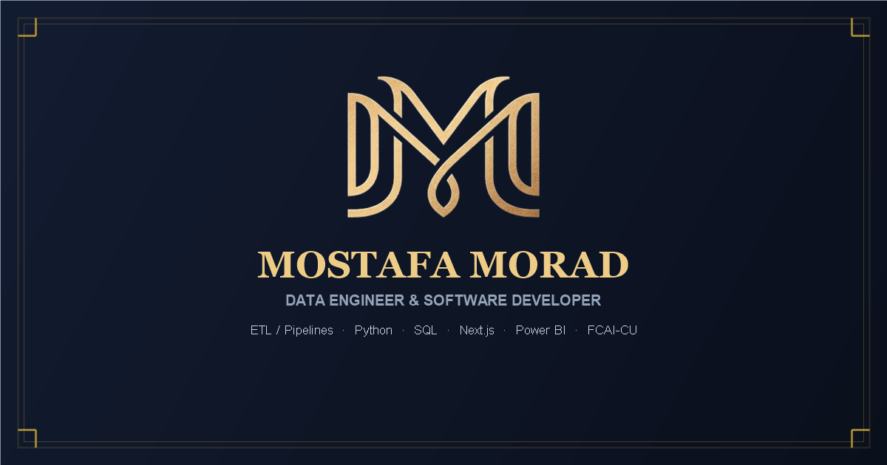

<div align="center">

  # 🌟 Mostafa Morad — Portfolio & Engineering Hub

  <p align="center">
    <strong>Production-Ready Data Engineering · Scalable Next.js Web Systems · High-Impact Analytics</strong>
  </p>

  <p align="center">
    <a href="https://morad.pages.dev">
      
    </a>
    <a href="https://github.com/mostafamorad1/portfolio">
      
    </a>
    <a href="https://wa.me/201015905993">
      
    </a>
    <a href="https://www.linkedin.com/in/mostafa-morad-sayed">
      
    </a>
  </p>

  <p align="center">
    
    
    
    
    
    
    
  </p>

  <br />

  <a href="https://morad.pages.dev">
    
  </a>

</div>

---

## 📌 Overview

Welcome to the official source repository of **Mostafa Morad's Portfolio** — an ultra-responsive, bilingual personal website and freelance services platform designed for high conversion, visual elegance, and edge performance.

The platform bridges the gap between **heavy data engineering pipelines** (ETL/ELT, PostgreSQL, Python, Data Warehousing) and **modern full-stack web engineering** (Next.js 15, React 19, TypeScript, Edge API routes).

- 🔗 **Live Website:** [https://morad.pages.dev](https://morad.pages.dev)
- 🚀 **Deployment Platform:** Cloudflare Pages (Edge Computing)
- 👤 **Author:** Mostafa Morad Sayed (*Operations Research & Decision Support at FCAI-CU & DEPI Fellow*)

---

## ✨ Key Features & Highlights

### 1. 🌌 Photorealistic Cosmic Engine (Solar & Starfield)
* **Dark Mode:** Deep space cosmic experience featuring dynamic multi-speed parallax starfields, twinkling stars, and atmospheric nebula gradients.
* **Light Mode:** High-contrast daylight theme with real-time solar flares, sun halo atmospheric glow, and cloud drift simulation.
* **Persistent Preference:** Theme choice is preserved seamlessly in `localStorage` without FOUC (Flash of Unstyled Content).

### 2. 🌍 Flawless Bilingual Experience (English LTR & Arabic RTL)
* Complete Arabic localization powered by locally bundled **Cairo Variable Font** (`CairoVF.woff2`).
* Crisp English typography powered by **Geist & Geist Mono Variable Fonts**.
* Instant language switching with CSS logical properties, zero layout reflows, and adaptive RTL mirroring.

### 3. 🐍 Physics-Driven Snake Navigation Bar (Services Hub)
* Custom sub-navbar engineered with a **unified mathematical Bézier SVG perimeter** (`Q` and `A` curves) descending gracefully from the top category tabs to hug the centered `All Services` tab.
* **Zero Seam Lines:** No awkward dividing lines or overlapping borders.
* **Snake Motion:** Powered by Framer Motion's shared `layoutId` with spring physics (`stiffness: 380, damping: 26`), enabling the active pill indicator to glide fluidly across rows like a snake.

### 4. 💰 Transparent Multi-Tier Pricing Modal
* Categorized pricing tiers for:
  * 💻 **Portfolio & Web Development**
  * 📄 **Word & PDF Documents Formatting**
  * 🎨 **PowerPoint Presentations**
  * ⚙️ **Data Engineering & ETL Pipelines**
* Outlines deliverables, included revisions, and extra revision fees.
* High-impact **Custom Project CTA Banner** linking directly to WhatsApp with pre-filled project inquiry text.

### 5. ⭐ Edge-Powered Dynamic Testimonials Platform
* **Zero-Fake Reviews:** Clean starting slate showing authentic feedback only when submitted.
* Interactive submission modal with 5-star rating selector and validation.
* Powered by Cloudflare **Edge Runtime API** (`/api/testimonials`) with resilient client-side `localStorage` caching.

### 6. 📱 100% Mobile & Accessibility (A11y) Optimized
* Full compliance with touch targets, focus-visible outlines, semantic HTML5, and ARIA labels.
* Perfectly responsive across all mobile viewports down to 320px screens.

---

## 🛠️ Tech Stack & Architecture

| Layer | Technologies & Tools |
| :--- | :--- |
| **Framework** | [Next.js 15.1.0](https://nextjs.org/) (App Router, Server Components) |
| **Frontend Library** | [React 19.0.0](https://react.dev/) |
| **Language** | [TypeScript 5](https://www.typescriptlang.org/) (Strict Mode) |
| **Styling** | [Tailwind CSS 3.4](https://tailwindcss.com/) with custom typography & animation extensions |
| **Motion & Physics** | [Framer Motion 13.2](https://www.framer.com/motion/) (Layout animations, AnimatePresence) |
| **Icons** | [Lucide React](https://lucide.dev/) |
| **Fonts (Self-Hosted)** | Local Cairo Variable Font (`CairoVF.woff2`) & Geist Variable Font (`GeistVF.woff`) |
| **Cloud & Deployment** | [Cloudflare Pages](https://pages.cloudflare.com/) + Edge Runtime (`@cloudflare/next-on-pages`) |

---

## 📂 Project Structure

```bash
portfolio/
├── public/
│   ├── assets/              # Logos, emblems, profile photography
│   ├── platforms/           # Freelance platform badges (Upwork, Mostaql, etc.)
│   ├── favicon.ico          # Multi-resolution favicons
│   ├── og-image.png         # OpenGraph social share card
│   └── Mostafa_Morad_CV.pdf # Downloadable professional resume
│
├── src/
│   ├── app/
│   │   ├── api/
│   │   │   ├── contact/     # Edge runtime anti-spam contact form API
│   │   │   └── testimonials/# Edge runtime reviews submission API
│   │   ├── fonts/           # Self-hosted variable font binaries (.woff / .woff2)
│   │   ├── globals.css      # Tailwind base, cosmic solar layers, custom scrollbars
│   │   ├── layout.tsx       # Root layout, local font loaders, OpenGraph metadata
│   │   └── page.tsx         # Primary single-page portfolio assembly
│   │
│   ├── components/
│   │   ├── Navbar.tsx       # Sticky floating glassmorphism navbar with language/theme toggles
│   │   ├── Hero.tsx         # Headline, USP, interactive CTAs, tech badges
│   │   ├── About.tsx        # Bio, core specializations, career milestones
│   │   ├── Education.tsx    # Academic journey at Cairo University (FCAI-CU)
│   │   ├── Credentials.tsx  # Certifications (DEPI, IBM, Meta, Kaggle)
│   │   ├── Skills.tsx       # Interactive technical, tools, and soft skill categories
│   │   ├── Experience.tsx   # Professional history and freelance track record
│   │   ├── Services.tsx     # Services showcase with unified curved snake sub-navbar
│   │   ├── PricingModal.tsx # Multi-service tiered pricing modal with custom project CTA
│   │   ├── Projects.tsx     # Filterable production projects with modal case studies
│   │   ├── Achievements.tsx # Metric-driven engineering achievements
│   │   ├── Testimonials.tsx # Dynamic reviews slider with interactive submission modal
│   │   ├── Contact.tsx      # Contact form with rate-limiting & direct contact cards
│   │   ├── Footer.tsx       # Clean footer with quick links and freelance platform pills
│   │   └── SpaceBackground.tsx # Photorealistic dark starfield & light solar engines
│   │
│   ├── context/
│   │   └── ThemeLanguageContext.tsx # Centralized React context for theme & language
│   │
│   └── data/
│       ├── portfolioData.ts # Complete bilingual text content, projects, and contact data
│       └── pricingData.ts   # Tiered pricing plans, add-ons, and revision policies
│
├── tailwind.config.ts       # Tailwind CSS configuration with customized palettes
├── tsconfig.json            # TypeScript configuration
└── package.json             # Project dependencies and deployment scripts
```

---

## ⚡ Quick Start & Local Development

### Prerequisites
* **Node.js**: v18.18.0 or higher (v20+ recommended)
* **npm**: v9.0.0 or higher

### 1. Clone the repository
```bash
git clone https://github.com/mostafamorad1/portfolio.git
cd portfolio
```

### 2. Install dependencies
```bash
npm install
```

### 3. Start local development server
```bash
npm run dev
```
Open **[http://localhost:3000](http://localhost:3000)** in your browser to view the live hot-reloading app.

### 4. Build for production
```bash
npm run build
```
Starts Next.js compilation, type-checking, and generates optimized static pages with Edge functions.

---

## 🌐 Deploying to Cloudflare Pages

This project is tailored to build and run on **Cloudflare Pages** using `@cloudflare/next-on-pages`:

1. In the **Cloudflare Dashboard**, navigate to **Workers & Pages** > **Create application** > **Pages** > **Connect to Git**.
2. Select the `mostafamorad1/portfolio` repository.
3. Configure the build settings:
   * **Framework preset:** `Next.js`
   * **Build command:** `npx @cloudflare/next-on-pages@1`
   * **Build output directory:** `.vercel/output/static`
   * **Node.js version:** `20.x` or higher (set via environment variable `NODE_VERSION: 20`)
4. Click **Save and Deploy**.

---

## 📬 Connect & Freelance Profiles

I am available for freelance contracts, consulting, and full-time engineering roles. Let's build something remarkable together!

* 📧 **Email:** [moradahmed854@gmail.com](mailto:moradahmed854@gmail.com)
* 📱 **WhatsApp:** [+20 101 590 5993](https://wa.me/201015905993)
* 💼 **LinkedIn:** [linkedin.com/in/mostafa-morad-sayed](https://www.linkedin.com/in/mostafa-morad-sayed)
* 🐙 **GitHub:** [github.com/mostafamorad1](https://github.com/mostafamorad1)

### Hire Me on Freelance Platforms
<p align="left">
  <a href="https://www.upwork.com/freelancers/~01cf535b92c8102dfb">
    
  </a>
  <a href="https://mostaql.com/u/Mostafa_Morad12">
    
  </a>
  <a href="https://khamsat.com/user/mostafa_morad12">
    
  </a>
  <a href="https://nafezly.com/u/Mostafa_Morad">
    
  </a>
  <a href="https://www.freelancer.com/u/mostafamorad7?frm=mostafamorad7&sb=t">
    
  </a>
</p>

---

## 📄 License

This project is licensed under the [MIT License](LICENSE) — feel free to explore the code, learn from the architecture, or reference design patterns.

<div align="center">
  <sub>Crafted with passion, physics, and scalable data engineering by <strong>Mostafa Morad</strong> © 2026</sub>
</div>
